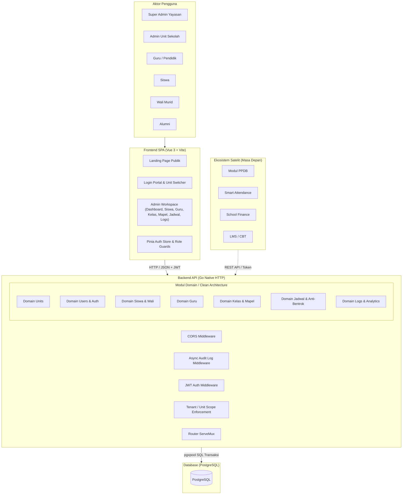

# Architecture Specification — EduCore School

## 1. Metadata dan Revision History
- **Proyek:** EduCore School
- **Modul:** School Core Management
- **Versi:** 1.0.0
- **Status:** APPROVED (Gerbang 2)
- **Arsitektur:** Modular Monolith (Go Native Clean Architecture) + SPA Frontend

---

## 2. Diagram Konteks Sistem



---

## 3. Struktur Repository & Pola Layering

Struktur modul mengikuti Clean Feature Architecture:

```text
backend/
├── config/             # Environment & PostgreSQL connection pool
├── features/           # Domain modules
│   ├── <module>/
│   │   ├── entities.go       # Struct entitas bisnis
│   │   ├── controllers/      # HTTP request handling & response formatting
│   │   ├── service/          # Business logic & validasi aturan
│   │   └── model/            # Query database PostgreSQL (pgx)
├── helper/             # Middleware, hashing, logging, HTTP response
├── router/             # Mux router mapping
└── main.go             # Application entry point

frontend/
├── src/
│   ├── api/            # Client Axios per modul
│   ├── stores/         # Pinia reactive stores
│   ├── router/         # Vue Router & navigation guards
│   ├── views/          # Halaman portal publik & admin
│   ├── components/     # Layout & UI components
│   └── main.js         # Frontend entry point
```

---

## 4. Arsitektur Isolasi Data Multi-Unit (Tenant Isolation)

Isolasi data antar-unit sekolah ditegakkan di sisi trusted backend:
1. **Identitas Pengguna:**
   Setiap akun pengguna diikat ke `school_unit_id` (kecuali Super Admin yang memiliki hak lintas unit).
2. **Klaim Token JWT:**
   Token JWT menyertakan `id`, `role`, dan `school_unit_id`.
3. **Penegakan di Layer Model / Query:**
   Semua query data (siswa, guru, kelas, mapel, jadwal) menyertakan filter:
   ```sql
   WHERE school_unit_id = $1 AND delete_at IS NULL
   ```
4. **Validasi Mutasi:**
   Saat membuat atau mengubah data, `school_unit_id` dari token pengguna disisipkan secara paksa untuk mencegah *cross-tenant data tampering*.

---

## 5. Arsitektur Deteksi Bentrok Jadwal (Conflict-Free Scheduling)

Algoritma validasi jadwal pelajaran memastikan tidak ada dua sesi belajar yang bertabrakan:
1. **Kriteria Bentrok:**
   - Guru yang sama mengajar di kelas lain pada hari yang sama dengan rentang waktu yang beririsan:
     `jadwal.hari = $hari AND jadwal.guru_id = $guru AND NOT (jam_selesai <= $jam_mulai OR jam_mulai >= $jam_selesai)`
   - Ruangan yang sama digunakan oleh kelas lain pada hari dan rentang waktu yang beririsan:
     `jadwal.hari = $hari AND jadwal.ruang = $ruang AND NOT (jam_selesai <= $jam_mulai OR jam_mulai >= $jam_selesai)`
2. **Penanganan:**
   Jika kondisi terdeteksi, operasi mutasi dibatalkan dengan response status HTTP 400 Bad Request dan rincian bentrok.

---

## 6. Observability dan Audit Trail
1. **Logging Asinkron:**
   Pencatatan ke tabel `transaction_logs` dijalankan dalam goroutine non-blocking setelah response selesai dikirimkan ke client.
2. **Masking Kredensial:**
   Field sensitif seperti `password`, `token`, `secret` otomatis disamarkan sebelum disimpan ke database.
3. **Penghematan Storage:**
   Request GET/HEAD yang berhasil (status < 400) tidak disimpan ke log database untuk mencegah bloat, sedangkan mutasi (POST, PUT, DELETE) dan error (status >= 400) selalu dicatat.

---

## 7. Accepted Technical Debt & Mitigasi
- **Technical Debt:** Endpoint API saat ini masih bergaya RPC (`/guru/tambah`, `/guru/update?id=...`).
- **Mitigasi:** Standarisasi alias endpoint RESTful (`POST /guru`, `PUT /guru/{id}`, `DELETE /guru/{id}`) akan disiapkan bertahap pada fase standardisasi kontrak tanpa merusak frontend yang ada.
